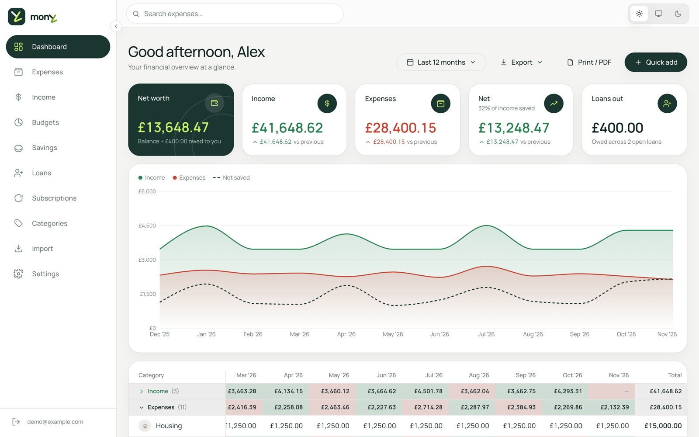
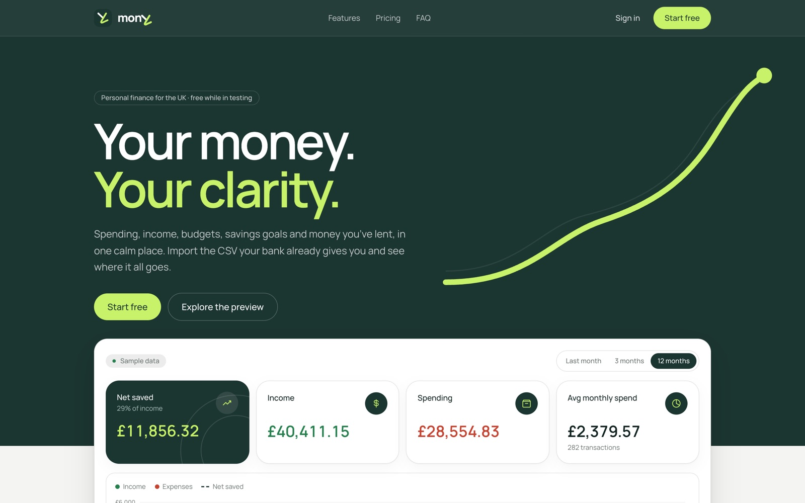
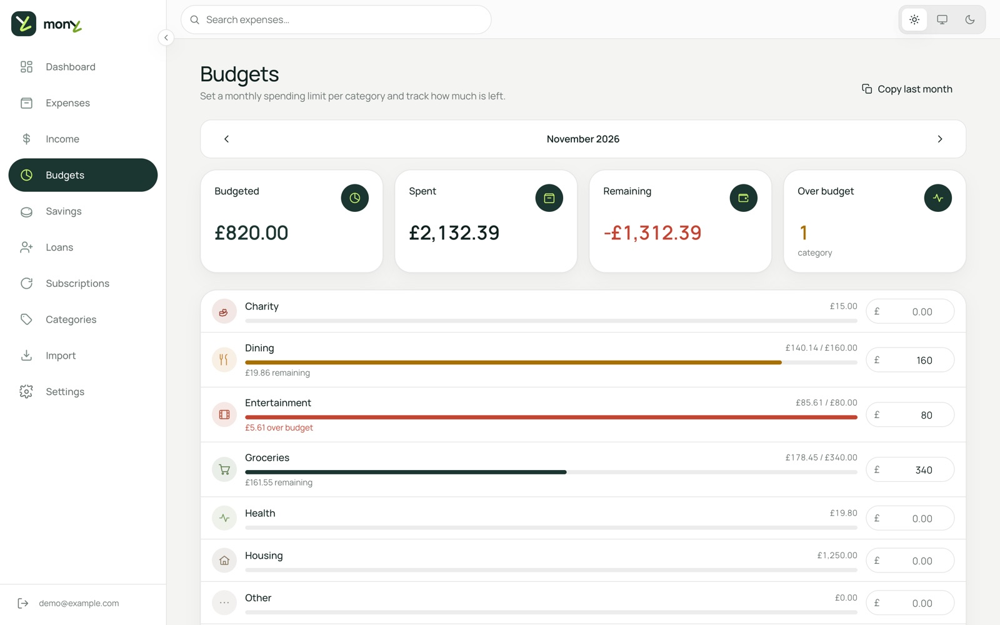
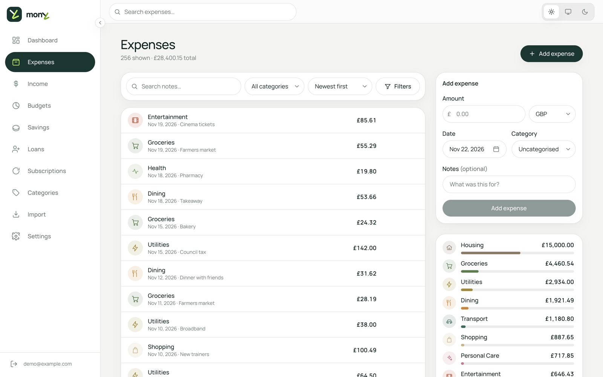

<div align="center">


# mony

**Your money. Your clarity.**

A personal finance app for the UK: spending, income, budgets, savings goals and money lent,
from the CSV exports your bank already gives you.

[](https://github.com/forty2-labs/mony/actions/workflows/ci.yml)
[Live site](https://mony-gray.vercel.app) · [Quick start](#quick-start) · [Security](#security)

<picture>
  <source media="(prefers-color-scheme: dark)" srcset="docs/screenshots/dashboard-dark.jpg" />
  
</picture>

</div>

## Features

- **Dashboard:** net worth, income vs spending, monthly trends and a category-by-month table.
- **Bank import:** CSV exports from Monzo, Revolut, Wise or any bank, with suggested categories and
  transfer detection. Nothing is saved until you review it.
- **Budgets, savings goals, loans and subscriptions** in one place.
- **Any currency:** amounts convert to GBP at the rate on the day, frozen so history never shifts.
- **Your data, your call:** export everything as JSON, or delete your account and every row with it.
- **Light and dark themes**, and a public landing page with a live preview on sample data.

<table>
  <tr>
    <td></td>
    <td></td>
    <td></td>
  </tr>
  <tr>
    <td align="center">Landing page</td>
    <td align="center">Budgets</td>
    <td align="center">Expenses</td>
  </tr>
</table>

**Built with** React, TypeScript, Vite, Tailwind CSS and TanStack Query, on Supabase (Postgres, Auth,
Edge Functions).

## Quick start

You need Node 20+ and Docker.

```bash
npm install
npm run db:start                 # local Supabase in Docker (first run pulls images)
cp .env.local.example .env.local # the defaults work as-is
npm run dev                      # http://localhost:5173
```

Sign in with the demo account, **`demo@example.com` / `MonyDemo2026`**: a year of fictional data. In
development the sign-in page has a one-click **Demo account** button.

| Local tool | Address                  | What it's for                                    |
| ---------- | ------------------------ | ------------------------------------------------ |
| App        | <http://localhost:5173>  | Landing page when signed out, dashboard when in  |
| Mailpit    | <http://127.0.0.1:54324> | Catches every auth email; nothing is really sent |
| Studio     | <http://127.0.0.1:54323> | Browse the local database                        |

Stop with `npm run db:stop`; your local data is kept.

## Commands

| Command            | What it does                                         |
| ------------------ | ---------------------------------------------------- |
| `npm run build`    | Type-check and production build                      |
| `npm run lint`     | ESLint (also sorts imports)                          |
| `npm run format`   | Prettier                                             |
| `npm test`         | Unit tests, no database needed                       |
| `npm run test:db`  | pgTAP: row security on every table, no anonymous use |
| `npm run test:rls` | Cross-user attack suite against the local API        |
| `npm run test:all` | All of the above                                     |
| `npm run db:reset` | Wipe and rebuild the local database                  |

[CI](.github/workflows/ci.yml) runs all of these on every pull request, and `main` only accepts
pull requests that pass.

## Security

Every user's data is isolated in the database itself, not by the app:

- **Row Level Security on every table**, forced, with owner-only policies. The public key alone
  grants nothing.
- **No cross-user references:** foreign keys include the owner, because foreign-key checks skip RLS.
- **Proven by tests:** `test:rls` has one real user attack another's rows with forged IDs, foreign
  keys and RPCs.
- **Privileged work stays on the server:** the service-role key is used only by the
  `delete-account` Edge Function.

## Changing the schema

Migrations never run automatically.

1. Add the next numbered file in `supabase/migrations/`. Never edit one that has been applied.
2. Apply it locally: `npx supabase migration up`, or `npm run db:reset` to replay everything.
3. Update the hand-written types in `src/shared/types/database.ts`.
4. Follow the RLS pattern in `0003_security_hardening.sql`, add cases to `tests/rls/`, and run
   `npm run test:all`.
5. When deploying: `npx supabase db push --remote`.

## Deploying

1. Create a Supabase project (UK or EU region) and link it:
   `npx supabase link --project-ref <ref>`.
2. Push the schema and function: `npx supabase db push --remote`, then
   `npx supabase functions deploy delete-account`.
3. Allow your site to call the function: `npx supabase secrets set ALLOWED_ORIGINS=https://your-domain`.
4. In the Supabase dashboard, mirror the `[auth]` settings from `supabase/config.toml`: site URL,
   redirect allowlist, leaked-password protection, CAPTCHA and a real SMTP provider. Paste the
   email templates from `supabase/templates/` into Authentication → Emails, so email links open
   `/auth/confirm`. Keep API max rows at 1,000 or more.
5. Build with `VITE_SUPABASE_URL`, `VITE_SUPABASE_ANON_KEY` and `SITE_URL`, the public address
   used in link previews, `robots.txt` and the sitemap. On Vercel, `SITE_URL` defaults to the
   production domain.

## Project layout

```text
src/app/          App shell, router, query client
src/features/     One folder per area: auth, dashboard, expenses, landing, loans, …
src/shared/       Shared UI, helpers and types
supabase/         Migrations, Edge Functions, email templates, pgTAP tests
tests/rls/        Cross-user isolation tests
docs/             Screenshots, design notes
```

## Roadmap

mony is in its **testing phase**. Work is planned in stages and tracked in Linear.

### Shipped

- Multi-user security: forced row-level security, owner-scoped foreign keys and a cross-user attack
  suite
- Your data, your call: JSON export and full account deletion
- Landing page with a live preview, link previews and the rising-y brand

### Now: launch readiness

- [x] CI and branch protection
- [x] Email sign-in and reset links that work in any browser
- [ ] Hosted sign-in hardening: real email provider, CAPTCHA, leaked-password check
- [ ] One-click demo on the live site
- [ ] Demo accounts can't change their email or password
- [ ] Privacy policy, terms and cookie notice
- [ ] Security review and security headers
- [ ] Custom domain
- [ ] Error reporting from the live site

### Next: app improvements

- [ ] Loans: money borrowed, interest and repayment history
- [ ] Recurring transactions
- [ ] Import history, duplicate detection and undo
- [ ] Onboarding for new accounts
- [ ] Accounts and cards on each transaction
- [ ] Dashboard insights
- [ ] Mobile polish

### Later: payments

- [ ] Billing records and entitlements, written only by the server
- [ ] Lifetime access for a one-time $20, through Stripe
